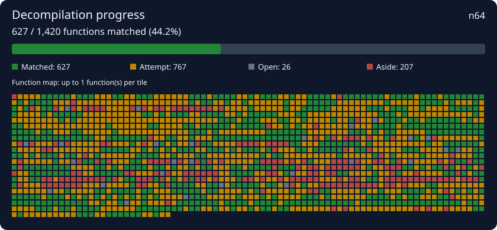

# South Park — Nintendo 64 decompilation

A saved [decompdecomp](https://github.com/RetroReversing/decompdecomp) project for the European Nintendo 64 release (`NDTP`). Clone it in the app and supply your own matching ROM to continue.

## Continue in decompdecomp

1. Install the latest [RetroReversing decompdecomp](https://github.com/RetroReversing/decompdecomp).
2. Choose **New project → Open a saved project**.
3. Paste **https://github.com/RetroReversing/south-park-decomp** as the repository address.
4. Select your own copy of the game and confirm ownership. Accept the required compiler installations when prompted.
5. Let the app split the ROM, restore the saved layout and compiler settings, and recheck the saved C. Then use Autopilot or start your agents to continue.

Use **Open a saved project** for this repository. The generic **Continue a public decomp** flow is for build-system repositories; this one is an app-native save. You can also clone this repo yourself and select its folder in Open a saved project.

## Checkpoint

- **627 saved C matches** from the working project and **834 unfinished best attempts**.
- A clean app import on 31 October 2026 verified **624 matches** and restored **812 best attempts**. Three saved matches need follow-up under the fresh analysis: `func_80276CA0`, `func_8028E9E0`, and `func_80406968`. Their sources remain preserved; do not count them as verified on import until the byte checker accepts them. One confirmed difference is a changed function boundary (8 bytes in the working project versus 16 bytes in the fresh import).
- **1,627 detected function entries**, including 207 set aside. The layout and count are provisional.
- Per-function compiler settings include SN Systems N64 compilers and GCC variants. The settings that recovered previously missing matches are preserved.
- A function counts as matched only after the app verifies it against your copy. Import counts can change with toolchain or analysis changes. This is an unfinished decompilation, not a claim that the complete cartridge rebuilds from C.

## Matching game

- Region: Europe (`NDTP`)
- Normalized ROM size: 16,777,216 bytes
- Normalized SHA-1: `c70c9fd6ebf1ae9f79155f9384ab1c4b29dc6882`

The app checks the game fingerprint. ROMs, extracted assets, original assembly, databases and compiler executables are not included.

## Files and contributions

- `src/`: verified function sources.
- `best/`: unfinished drafts; these are **not** verified matches.
- `include/`: shared compiler context.
- `decompdecomp.json`: fingerprint, function layout, names, compiler ranges, notes and attribution.

After working in the app, commit the saved progress files from its checkout. Keep compiler overrides alongside the source they verify. Preserve existing matches and verify changes with the ordinary byte checker. Names and types remain provisional. See [NOTICE.md](NOTICE.md) for provenance.
